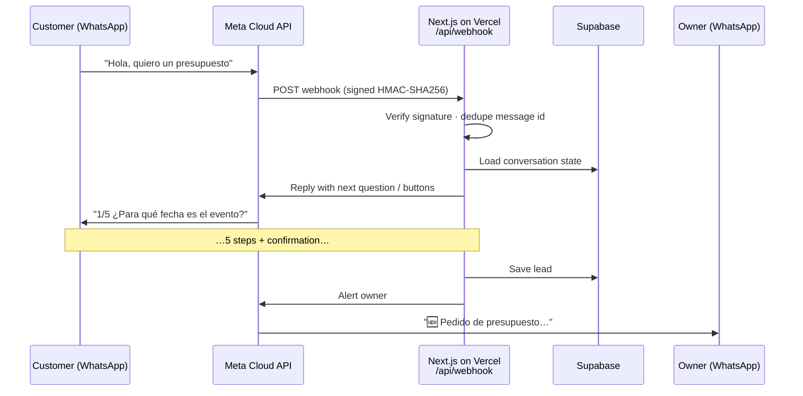
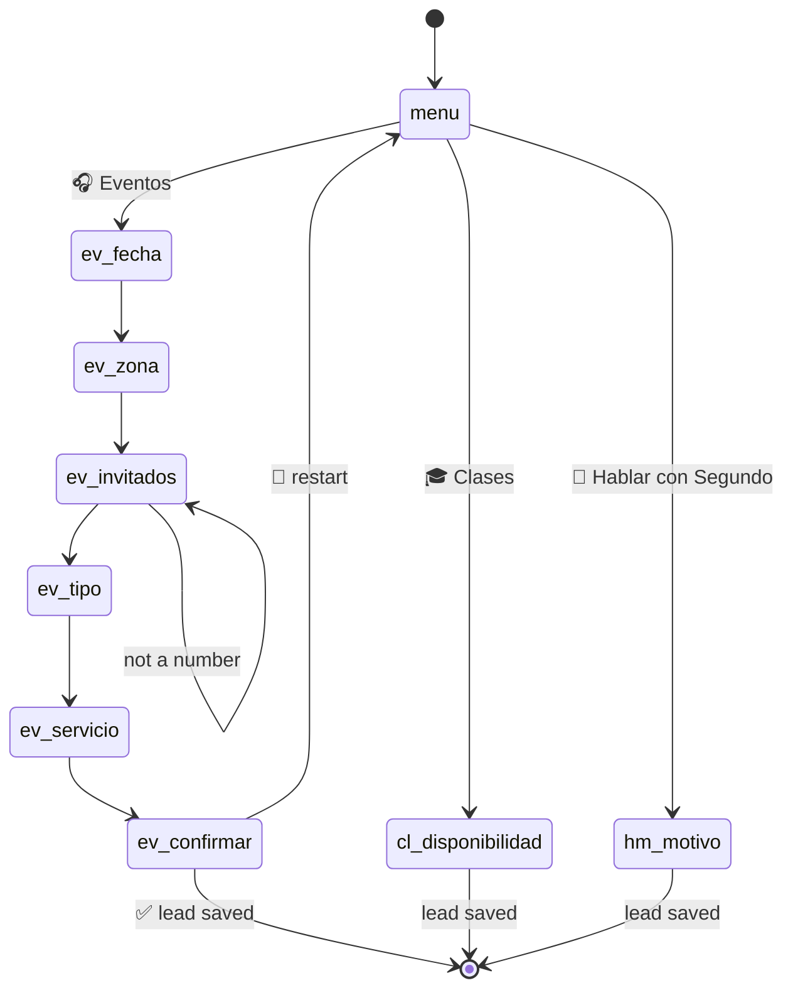

# ABUNDANCE Bot — WhatsApp lead-capture bot

A WhatsApp chatbot for **ABUNDANCE Productions**, an events company in Buenos Aires (DJ, sound and lighting). It answers customers 24/7, collects everything needed for a quote through a guided conversation, stores each lead and alerts the owner instantly.

**Live:** [abundance-bot-nu.vercel.app](https://abundance-bot-nu.vercel.app) · **Stack:** Next.js 15 · TypeScript · WhatsApp Cloud API · Supabase · Vercel · Vitest

---

## The problem

Event quotes always start the same way on WhatsApp: *"How much for a DJ?"* — followed by a long back-and-forth to find out the date, venue, guest count and services. Leads got lost in the chat history and replies depended on being available.

## The solution

A bot built directly on Meta's **WhatsApp Cloud API** (no third-party chatbot platform) that:

- **Guides a 5-step quote** — date, venue, guests, event type and service — using interactive reply buttons, then shows a summary to confirm.
- **Handles three intents** — event quote, DJ class inquiry, or hand-off to a human — via buttons, numbers or keywords (`"presupuesto"`, `"curso"`…).
- **Stores every lead** in Supabase (Postgres) and lists them in a password-protected **`/admin`** dashboard.
- **Notifies the owner** on WhatsApp with the full summary as soon as a lead is confirmed.
- **Remembers where each customer is** in the conversation (state machine with a 2 h timeout), so it works across serverless invocations.

## How it works



### Conversation flow



Typing `menu`, `hola` or `cancelar` resets the conversation from any step.

## Technical highlights

| | |
|---|---|
| **Testable core** | The conversation logic (`lib/bot.ts`) receives its dependencies (store, senders, notifier) by injection, so it's fully unit-tested without calling Meta or a database. |
| **Webhook security** | Every request is verified against Meta's `X-Hub-Signature-256` HMAC with a constant-time comparison (`lib/signature.ts`). |
| **Idempotency** | Meta retries webhooks; recently processed message ids are skipped so customers never get double replies. |
| **Pluggable persistence** | `Store` interface with two implementations: Supabase via its REST API (no SDK) and in-memory for local dev/tests. |
| **Real-world edge case** | Argentine mobile numbers arrive as `549 11…` but Meta's test allow-list stores them as `54 11 15…`; `normalizeAR()` bridges the two formats (error 131030). |
| **Zero-dependency admin** | `/admin` is a React Server Component protected with HTTP Basic Auth in Next.js middleware. |

## Project structure

```
app/
  api/webhook/route.ts   Webhook: verification (GET) and incoming messages (POST)
  admin/page.tsx         Leads dashboard (Basic Auth)
  privacidad/page.tsx    Privacy policy (required by Meta)
  page.tsx               Project landing page
lib/
  bot.ts                 Conversation state machine
  whatsapp.ts            Cloud API client (text, buttons, read receipts)
  store.ts               Supabase / in-memory persistence
  signature.ts           HMAC-SHA256 webhook verification
middleware.ts            Protects /admin
supabase/schema.sql      Tables: sessions, leads
tests/                   Vitest unit tests
```

## Running it

```bash
npm install
cp .env.example .env.local   # fill in the values
npm run dev
npm test                     # 16 unit tests
```

**Meta setup:** create an app at developers.facebook.com with the *WhatsApp* use case → copy the token and phone number ID → set the webhook URL to `https://<your-domain>/api/webhook` with your `WEBHOOK_VERIFY_TOKEN` → subscribe to the `messages` field.

**Optional:** run `supabase/schema.sql` in Supabase and set `SUPABASE_URL` + `SUPABASE_SERVICE_ROLE_KEY` to persist leads; without them the bot keeps state in memory.

## What I'd add next

- Move from the test number to the business's production number
- AI fallback (LLM) for free-text questions outside the flows
- Approved message templates to follow up after 24 h
- Lead status management (new → quoted → booked) from the dashboard

---

Built by **Segundo Pinto** — [Portfolio](https://portfolio-segundo.vercel.app/) · [LinkedIn](https://www.linkedin.com/in/segundo-pinto-428b28287/) · [GitHub](https://github.com/djpinto2)
